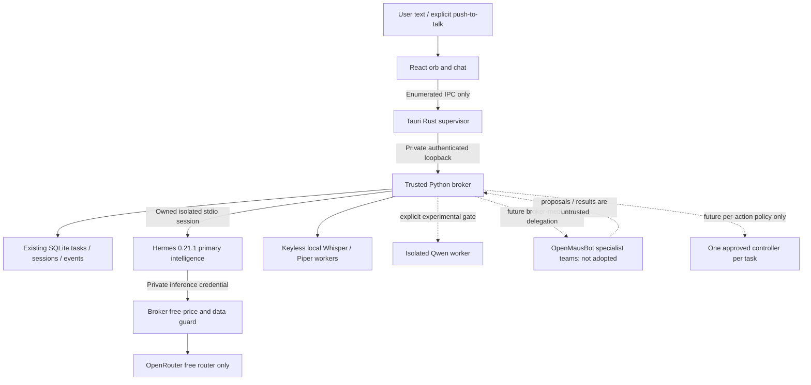

# Architecture consolidation — 2026-11-13

The user's mandatory consolidation rules override older integration suggestions.
This records the audited current architecture and decisions, not completed future
features. No memory, scheduler, controller, account or external agent was migrated.

## Current owners and reuse decisions

| Capability | Current authority | Decision |
|---|---|---|
| Reasoning/planning and responses | Hermes | Retain reviewed 0.21.1; no new agent loop or automatic upgrade |
| Permission decisions, admission, deadlines, cancellation | Immortility broker | Every future privileged action must cross this boundary, including delegated actions |
| Desktop window/tray/native process tree | Tauri supervisor | Retain; it is not a generic computer-use service |
| Conversation history and task evidence | Existing broker SQLite WAL store | Retain as sole application writer; seed bounded successful history into isolated Hermes sessions |
| User's external Hermes memory/jobs | Their existing installation | Not read, migrated, replaced, deleted or enabled by this audit |
| Immortility long-term approved memory | Not enabled | Evaluate existing Hermes provider hooks first; broker controls consent/provenance/deletion. No parallel vector database or automatic OMB memory synchronization |
| Immortility scheduled work | Not enabled | Hermes cron is the first candidate. Select one executor only after broker-authorized triggers, restart and cancellation tests. No competing scheduler was built |
| Specialist teams | OpenMausBot designated candidate | Replace the planned Grok Bot integration, not the unrelated installed Grok app. No dispatch until installation, pairing, cost and per-action policy gates pass |
| Active computer controller | None enabled in Immortility | Evaluate OpenMausBot Windows CUA first. Do not enable its direct execution until broker enforcement is demonstrated; one task/controller owner, no simultaneous competing input stacks |
| Browser execution | None enabled | Benchmark OpenMausBot's bundled browser first. Browser Use only for a measured missing capability; it is not installed |
| Local speech | Existing Whisper/Piper, experimental Qwen | Retain engines; fix lifecycle defects. Qwen defaults off because its separate dependency graph has unresolved advisories |

## What already exists upstream

Installed Hermes source contains TUI, ACP and HTTP adapters, memory providers,
skills, cron storage/execution, delegation, browser/computer modules and MCP.
Presence does not establish policy compatibility. Immortility's isolated profile
still disables all 59 catalog toolsets, durable memory, hooks, plugins, MCP and
lazy installation, and checks the realized tool inventory before each prompt.
Full commit/version and tracked-source integrity now fail closed at startup.

Audited OpenMausBot source includes specialist coordination, local bot memory,
an MCP manager, a built-in Chromium/CDP browser and a Windows bundled CUA host.
Its bot memory is on by default upstream. Its MCP control plane cannot change
approval/computer settings or approve prompts. A dispatch permission alone is not
authorization for every action a delegated bot may take. An OpenMausBot approval
card alone does not replace Immortility's broker policy.

## Adoption contract

1. Keep the working app usable when an optional runtime is absent.
2. Pin the reviewed runtime/build, verify its tool inventory and free-model route.
3. Isolate a dedicated team, models, token and workspace; never inherit unrelated
   account permissions or global memory.
4. Begin with text/proposal-only specialists with computer, shell, files,
   scheduling and external account tools off. Verify those settings independently;
   do not trust a bot's statement that it is restricted.
5. Later expose only broker-scoped capabilities. If upstream cannot route every
   privileged action through the broker, that execution path remains blocked.
6. Bind parent/child IDs, request identity, allowed resources, deadline, budget and
   cancellation to one delegation owner. No Hermes ↔ OMB recursive delegation loop.
7. Use one scheduler and one memory ownership strategy. Keep the current stores
   until a measured alternative is materially better and migration/rollback tests pass.
8. Keep optional execution behind a default-off feature gate until native end-to-end,
   reliability, cancellation and CPU/RAM/GPU measurements pass. No paid service,
   unrestricted tool or external account is activated by installing a repository.

## Current security boundaries

The webview has event listening only and no generic shell/filesystem/HTTP plugin.
Rust accepts a fixed operation enum and validates resource IDs; it retains broker
authentication. The broker listens on ephemeral loopback with token, Host and
Origin checks. Provider credentials remain in backend Credential Manager storage.
Hermes receives an isolated local inference credential; live catalog checks and
rebuilt payloads prevent paid fallback. Local speech has no cloud audio endpoint.
Worker output is untrusted: Qwen cleanup now accepts only the broker's expected
WAV path, and timeout/cancellation reaps the owned process rather than merely
queueing a message behind synchronous GPU work.

Read [the repository matrix](../integrations/REPOSITORY_MATRIX.md),
[OpenMausBot adoption gates](../integrations/OPENMAUSBOT.md), and
[P0 evidence](../phases/P0_AUDIT.md) before implementing a new subsystem.
