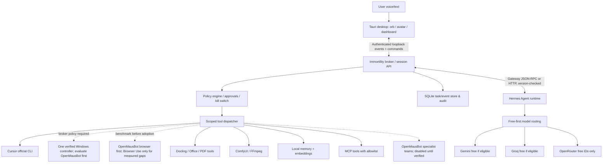

# 01 — System architecture

The mandatory [consolidation decision](../architecture/CONSOLIDATION.md) takes
precedence over older optional-integration suggestions. Preserve existing memory,
scheduling and computer-use ownership unless a measured alternative is materially better.

## Deployment choice
**Local modular monolith + isolated worker processes, not many always-running microservices.** Host a Tauri 2 desktop UI (React/TypeScript) and a localhost Python FastAPI broker. Broker manages sessions, event replay, capability registry, policy, logging and orchestration adapters. Heavy services start on demand. Hermes is an external agent runtime reached through its documented gateway protocol; user data stays local until a cloud call has a valid policy/consent basis.

## Trust zones
- **Zone 0 UI:** untrusted webview; cannot read API keys, filesystem or execute arbitrary processes. Tauri capability ACL minimal.
- **Zone 1 broker:** loopback bind, authenticated per-launch session, explicit origins, input validation, no unauthenticated CORS.
- **Zone 2 privileged adapters:** Windows UIA / file operations / subprocess; path allowlist, approvals, timeouts, sandbox and audit before action.
- **Zone 3 external processes:** Hermes, Cursor CLI, Browser Use, ComfyUI, document converters. Treat output as untrusted; constrain directories and network where feasible.
- **Zone 4 cloud:** Gemini/Groq/OpenRouter; outbound data egress controlled and explained; paid models blocked.

## End-to-end turn flow
1. UI obtains text or local STT transcript; receives a task/session ID.
2. Broker validates session and declared capability access. Persist initial event.
3. Hermes gets a request with available tools, context, budget and permission constraints.
4. Hermes chooses capabilities; broker checks each side-effecting tool call independently (do not rely only on prompt instructions).
5. If approval required, emit pending-approval event and *pause* until user acts or timeout.
6. Tool workers emit progress; cancellation token is propagated to process groups and future tasks.
7. Verify output (test results, checksums, file existence, screenshot diff, web evidence etc.).
8. Persist summary and audit record; return concise spoken/written result. Store durable memory only if policy allows.

## Source of truth and transport
- Frontend gets task events from broker over a localhost WebSocket or SSE; commands via authenticated HTTP. One event schema across UI panels.
- SQLite WAL holds sessions, tasks, tool calls, approvals, audits and resumable job state. Each event has monotonic sequence per task and correlation ID.
- Hermes is **not duplicated**: use TUI gateway JSON-RPC for rich control when reliable, HTTP API server for minimal first vertical slice. The integration doc describes `POST /v1/runs` and `GET /v1/runs/{id}/events`; check installed version before implementing. **Hermes ships built-in terminal/file/browser/computer tools; disable all unmediated privileged toolsets in P1.** A broker policy is not a security control if Hermes can bypass it by invoking its own built-in tools. Use documented toolset restrictions and isolated workspace; re-enable individual capabilities only after independent enforcement is demonstrated.
- Only one broker owns task orchestration; no simultaneous duplicate event loops. Tool callbacks are idempotent where possible.
- Project memory is namespaced by workspace; per-task ephemeral context is separate from opt-in durable memory.

## Failure modes
- Cloud provider 429/unavailable → respectful retry-after and free-only fallback; no paid fallback.
- Hermes unavailable → UI still starts, shows disconnected state, offers diagnostics; does not fabricate answers.
- Cursor crash → worker becomes failed, retains diagnostics; no unverified success.
- UI crashes → broker event store supports reconnect & replay; browser/video tasks have cancellation and TTL.
- OS control loses focus → abort hazardous input, reacquire target window after reconfirmation.
- Local PC restart → resumable safe tasks recovered from SQLite; irreversible workflows require reapproval.

## Design constraints
No fixed TCP port exposed to LAN; default 127.0.0.1; session token exchange must avoid putting secrets in browser local storage or query strings; constrain native commands using enums/allowlists instead of generic `exec` from React.
