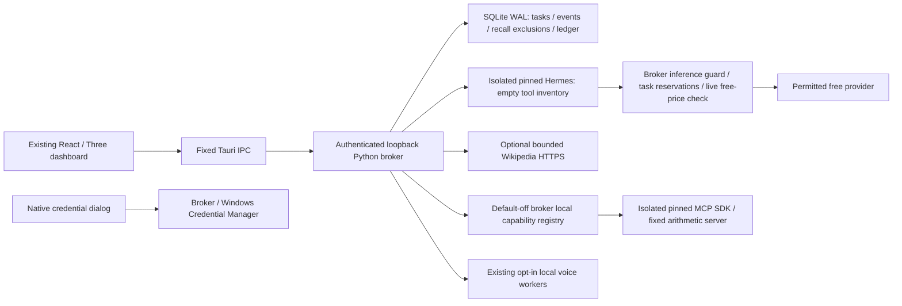

# Current architecture and trust boundaries

Hermes is the sole planning/reasoning runtime. Arithmetic and clock are broker local routes. The existing Engine also executes explicit read-only DAGs without a model; it is not a second planning loop. No framework, scheduler, vector memory owner, browser controller or Windows input runtime was introduced.

| Domain | Authority | Enforcement |
|---|---|---|
| Task lifecycle / admission / Stop | Python broker | Durable states; one current task; task-owned workers and post-write review; revocation of pending approvals |
| Provider access / budget | Broker | Rotated per-grant bearer; fixed provider/model; every call rechecks live $0 pricing; atomic persisted reservations; no paid fallback |
| Tools / scopes | Broker gateway | Two fixed reviewed registrations; exact arguments and matching session/task/ledger attempt; expiring consumed grant; schema validation; deadline and one lock |
| Process lifetime | Rust supervisor + per-worker broker Windows jobs | Kill-on-close; reviewed child starts suspended, job attaches, primary thread resumes; exact owned tree reap |
| History / recall | Broker SQLite | Evidence retained; `recall_excluded` consulted by all automatic task recall; FTS is derived, not a competing memory owner |
| Credentials | Native Rust dialog + broker vault | Keys stay outside React state and generic webview payload; no values in health, manifests or usage records |
| File patches | Broker workspace adapter | Approved root; reparse/alias rejection; byte hash/existence binding; journal before atomic replacement; verified readback and guarded rollback |
| UI / avatar | Existing Tauri/React/Three app | Presentation only; no provider key or arbitrary command tunnel |

## Important limits

Windows jobs provide process ownership and cleanup, **not filesystem/network isolation**. Environment allowlisting is not an OS sandbox. There is no accepted boundary for executing hostile repository code; that production flag remains hard-disabled. Qwen also remains hard-disabled pending its separate vulnerability work.

Remote documents, source code, web extracts, server descriptions and model output are data. They cannot expand a grant, select an executable, add an account, change a price or bypass approval. Only integer values are accepted by the experimental MCP slice; clock has an empty typed input. Durable workflows bind only typed local read dependencies. No OAuth or remote MCP transport is enabled.

The public fetcher accepts only HTTPS `en.wikipedia.org:443`; mixed/private DNS answers are rejected and the actual socket connects to the validated numeric IP with original TLS SNI. Redirects and compressed responses are refused. Production research uses this async path; the retained synchronous helper is legacy fixture compatibility, not an approved egress primitive.

Unknown provider usage remains a full conservative reservation. Cache/reasoning details are stored as reported subfields and are not added twice to prompt/completion totals. UTF-8 byte reservations are deliberately conservative for the variable free-router tokenizer; context that cannot fit is rejected. Live accounting accuracy and complete per-specialist attribution remain acceptance work.

Forget means exclusion from automatic recall, not deletion of evidence. SQLite main/WAL files, v1/v2 upgrade backups, saved approvals and rollback records can contain personal content. Physical erase, retention/export/correction UI and tamper-evident auditing are not certified. Admission before research/persistence and the inference egress guard cover configured keys and specific recognizable formats; it cannot recognize every possible secret or replace task-scoped upload consent.

## Verified upstream API references

- [Microsoft process creation flags](https://learn.microsoft.com/en-us/windows/win32/procthread/process-creation-flags), [ResumeThread](https://learn.microsoft.com/en-us/windows/win32/api/processthreadsapi/nf-processthreadsapi-resumethread), [THREADENTRY32](https://learn.microsoft.com/en-us/windows/win32/api/tlhelp32/ns-tlhelp32-threadentry32).
- [Native CredUI API](https://learn.microsoft.com/en-us/windows/win32/api/wincred/nf-wincred-creduipromptforcredentialsw).
- [HTTPcore network backends](https://www.encode.io/httpcore/network-backends/).
- [Official MCP SDK 2.2.0 release](https://github.com/modelcontextprotocol/python-sdk/releases/tag/v2.2.0), [PyPI release/provenance/license](https://pypi.org/project/mcp/2.2.0/). SDK client/server source and dependencies are pinned locally; arbitrary current-main changes are not accepted at runtime.
