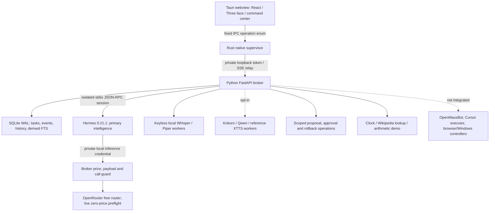

# Immortility architecture and GitHub ecosystem audit

**Audit date:** 14 November 2026 (Asia/Kolkata). **Decision:** retain Hermes, Python broker, Tauri/React/Three.js and the existing working paths. Close permission, cancellation, memory-deletion and accounting gaps before admitting new tools. The highest-value capability experiments are read-only Serena retrieval, a standard broker-owned MCP client, bounded local web extraction and one Windows UIA controller.

This audit made no dependency installations, upgrades, runtime activation, model downloads, account pairing or application-source changes. It added research reports and ran existing checks plus temporary, synthetic probes. It did not send private workspace contents, audio, screenshots or live inference requests to a model. Public GitHub research and dependency-advisory requests used network access. Existing modified/untracked work was preserved; the checkout is a working development tree, not a clean release.

## Read this report with its companion artifacts

1. [All 138 decisions, dependency/license/resource profiles](ECOSYSTEM_CANDIDATE_MATRIX_2026-11-14.md).
2. [Ranked plan, phase gates and acceptance benchmarks](ECOSYSTEM_IMPLEMENTATION_ROADMAP_2026-11-14.md).
3. [Local installed-package inventory and source hashes](ECOSYSTEM_LOCAL_INVENTORY_2026-11-14.json).
4. [Upstream URL and license evidence register](ECOSYSTEM_UPSTREAM_EVIDENCE_2026-11-14.json).
5. Fresh advisory scans: [pnpm](ECOSYSTEM_PNPM_AUDIT_2026-11-14.json), [broker](ECOSYSTEM_PYTHON_AUDIT_2026-11-14.json), [INFERNAL](ECOSYSTEM_INFERNAL_AUDIT_2026-11-14.json), [reference TTS](ECOSYSTEM_REFERENCE_TTS_AUDIT_2026-11-14.json) and [Qwen](ECOSYSTEM_QWEN_AUDIT_2026-11-14.json).
6. [Reproducible audit probes and check results](ECOSYSTEM_VERIFICATION_2026-11-14.md).

## Method, boundaries and confidence

Read README, AGENTS, the master coding prompt, blueprint architecture/roadmap/security/cost/contracts/testing/operations/Windows/capability specifications and the full 138-row research document. Inspected the actual broker, native supervisor, frontend state/transport/face/voice code, contracts, tests, manifests, locks, integration metadata and installed environments. Examined installed Hermes source without reading its personal memory, credentials or schedules. Existing earlier audit/performance reports were treated as historical evidence, not retested claims.

Every input GitHub candidate received a landing-page request and license/README lookup. Promising candidates also received targeted documentation/manifest/source review. Some results are cached (two months for one GBrain wrapper); the register preserves that distinction. Exact last-commit dates and release cadence were not independently established for all projects. No candidate was installed, benchmarked or certified safe merely because its page was reachable. License observations do not close transitive, model-weight, data, asset or hosted-service terms. Current main-branch source is review evidence, not an approved dependency pin.

Status vocabulary: **verified** means the named executable check passed in this audit, only for its stated scope; **integrated** means an actual application path exists but its physical/native/cloud outcome was not demonstrated here; **mocked** means deterministic fake Hermes/provider/audio evidence; **stub** means narrow demo or placeholder; **planned** means no application implementation. A visual status or a `verifying` state is not independent task verification.

Short audit plan: establish source/dependency baseline; execute offline safety and lifecycle checks; reconcile Hermes-native features; review all candidates and shortlist source; produce constrained roadmap and measurable promotion gates. Primary risks: confusing upstream availability with enabled capability, overlapping owners, unmeasured hardware/token claims, tool bypass of broker policy, and carrying stale license/version assumptions into installs.

## Actual architecture

The modular monolith is appropriate for a single-user Windows laptop. Do not add a daemon per feature. Preserve one authority for approvals, task admission, cancellation and budget reservations. Hermes remains the planner; the broker's small deterministic mode selector is adapter policy, not justification for another agent framework.

### What exists and what the evidence establishes

| Subsystem | Actual implementation and evidence | Status / practical limit |
|---|---|---|
| Desktop shell | Tauri 2.12.4, Rust process supervisor, ephemeral broker connection, fixed IPC enum, tray/window/hotkey controls, Windows kill-on-job-close boundary | **Integrated**; four Rust unit tests **verified**. No fresh physical window, tray or hotkey test here; development binary is not a portable installer |
| Frontend | React 19.3.1, Three 0.170.0, R3F 9.3.0, GSAP; compact/chat/command/overlay surfaces; lazy scene/dashboard imports, bounded frame pacing and 2D fallback | 41 frontend tests **verified**; TypeScript and ESLint passed, Prettier failed. Screenshots/performance fixtures in earlier work include mocks and software WebGL |
| Broker API | FastAPI/Pydantic, loopback auth, Host/Origin checks, strict schemas, event replay, one active generation, idempotent task admission, structured errors | **Integrated**; offline contract tests cover many paths. Generic task-scoped capability tokens and complete manifest enforcement are still **planned** |
| Hermes transport | Official TUI stdio JSON-RPC `session.create`, `prompt.submit`, events and interrupt; temporary HERMES_HOME and allowlisted environment | **Verified** real pinned Hermes + fake provider: response, unsafe-output block, process cancellation. No live cloud answer measured in this audit |
| Provider policy | Only `openrouter/free`; verify catalog per outgoing request, rebuild payload, max-price zero, reject tools/functions/non-text, max 2,048 output tokens per call | **Integrated/verified offline**. Gemini/Groq/NVIDIA keys are storage-only. No local LLM route, cache, account eligibility fallback or aggregate token ceiling implemented |
| SQLite | WAL, foreign keys, schema version, tasks/events, successful history, recovery marks unfinished tasks disconnected | **Integrated**, deterministic restart/replay coverage. Not a durable workflow resumer or tamper-evident audit ledger |
| Memory | Broker `memory.py` keyword overlap, bounded history, project-memory text, prior successful tasks, session-filtered FTS5 | **Integrated** lexical retrieval, not semantic long-term learning. Derived FTS writes happen automatically; no full durable-memory consent/correction/export model |
| Specialists | Broker starts tool-free Hermes research/coding/review sessions; two can run concurrently, parent synthesis follows when necessary; checkbox defaults off | **Integrated**, fake-runtime tests. This is bounded broker orchestration, not Hermes native delegate_task or OpenMausBot teams; model review verdict is not a test |
| Workspace operations | Approved root, limited text suffixes, 20-file scan, 8,000-byte reads, 12,000-character prompt slice, full-file PATCH proposal, hash check, preview/approve and saved rollback | **Integrated**, mocked-model tests. Real test execution permanently disabled; Windows casing/CRLF defects reproduced below |
| Local tools | Fixed `clock` endpoint | **Integrated**, UI-invoked. No universal model-visible tool registry |
| Web | Wikipedia-only HTTPS allowlist, DNS public-address check, no redirects, one summary plus citation | **Integrated**, mocked HTTP test. Not general browsing/search; task wiring and DNS/cancellation limits remain |
| MCP | Fixed local arithmetic process, only `add` authorized, custom framing | **Stub/demo**; local math roundtrip works, standard MCP interoperability is not established |
| Push-to-talk | Explicit microphone consent, 30-second worker cap, local faster-whisper base CPU INT8, VAD, transcript review without cloud consent, local Piper output | **Integrated**. Consent and fake audio tests pass; no microphone capture/playback was requested in this audit |
| Additional speech | Kokoro INFERNAL, Qwen clone worker, reference XTTS worker, isolated environments, model hashes and consent-related contracts | **Integrated opt-in/experimental**. Historical INFERNAL playback evidence exists; Qwen gate remains off for unresolved security. Reference path is newer working-tree code, not automatically verified |
| Cursor/OpenMausBot | No application execution adapters; source-protocol probe and design documents exist | **Planned**, OpenMausBot absent at standard install path. Do not infer Cursor login/entitlement or absence elsewhere on disk |
| Screen/browser/OS tools | No enabled application screen capture, browser controller or Windows controller | **Planned**; development screenshot scripts and visual overlay do not constitute a user-authorized computer controller |
| Scheduler, artifacts, media | No enabled scheduler; no general document authoring/ingestion, ComfyUI or media workflow dispatcher | **Planned**. Blender is an existing asset-build workflow, not an agent runtime service |

### OpenMausBot: source, installation and control-plane reality

The actual standard path `C:\Users\reyan\AppData\Local\Programs\OpenMausBot\OpenMausBot.exe` was checked outside sandbox redirection and is absent. This is not a whole-disk absence claim. No OpenMausBot process, account pairing or team dispatch was started.

The previously cached source is **milind-soni/OpenMausBot 0.1.155**, recorded at `d76d0248fe83b8a85033800ccdae4876bfae1578` in the earlier upstream audit. Its package manifest was read directly: Node >=24, pnpm 10.33.0, Apache-2.0, and separate Electron/harness/browser/CUA build paths. Current public [source manifest](https://github.com/milind-soni/OpenMausBot/blob/main/package.json) reports **0.1.158**, still Node >=24. Host Node 22.13.1 and pnpm 10.27.0 do not satisfy that declared toolchain. The older catalog-only probe is neither a full-app benchmark nor a supported-version waiver.

Cached `scripts/mcp-server.ts` explicitly limits bot-profile updates so they cannot change permissions/computer/approval settings; its server instructions exclude approval grants, deletion and computer lifecycle. This is useful fail-closed design, but also means its MCP control plane alone cannot establish Immortility's full per-action approval/cancellation boundary. Supported provider drivers are not a native Hermes adapter; preserve tool-free Hermes specialists until a real interop/ownership test passes.

The research inventory's `OpenMausBot/OpenMausBot` URL is a different, download-oriented repository with conflicting copied README/license metadata. Follow the source manifest's **milind-soni/OpenMausBot** identity and [licensing document](https://github.com/milind-soni/OpenMausBot/blob/main/LICENSING.md), not an assumed organization-name match. Matching a future binary to that reviewed source and third-party notices remains an adoption gate.

### Installed dependencies and duplication

The installed broker interpreter is Python **3.13.11**. Node is **22.13.1**, pnpm **10.27.0**, uv **0.12.10**. Broker FastAPI 0.162.5, Starlette 1.3.1, Uvicorn 0.34.2, HTTPX 0.28.1 and Pydantic 2.11.4 match direct pins. ASR/TTS packages include faster-whisper 1.2.1, CTranslate2 4.9.0, Piper 1.8.0, SoundDevice 0.5.6, PyAV 18.0.0 and ONNX Runtime 1.31.1. The generated inventory lists the full installed graphs instead of assuming the lockfile alone proves installation.

| Existing environment | Installed packages checked | Logical file size measured | Important split |
|---|---:|---:|---|
| `.venv` | 79 | 0.39 GiB | Broker, test tools, Whisper/Piper; Python 3.13 |
| `.venv-infernal` | 101 | 0.99 GiB | Python 3.12, Kokoro 0.9.4, Torch 2.15.0, Transformers 5.15.1, DSP |
| `.venv-reference-tts` | 104 | 3.51 GiB | Python 3.12, Coqui 0.28.0, Torch 2.15.0+cu132, TorchAudio 2.11.1 |
| `.venv-tts` | 89 | 4.76 GiB | Python 3.13, Qwen 0.1.1, Torch/TorchAudio 2.11.0+cu128, Transformers 4.57.3 |

Total is approximately **9.65 GiB logical file lengths**, not unique physical allocation. Hardlinks can double count; external model downloads, caches, Hermes, Rust build output and node_modules are excluded. Installed graph consistency passed for all four. Consistency is not vulnerability clearance or native inference compatibility.

There are already several speech workers, lifecycle implementations and incompatible Torch environments. Isolation is justified by incompatible pins; consolidation should first unify broker worker contracts and resource arbitration, not force packages into one venv. Preserve current selected voices and profiles. Do not add Handy, Pipecat, LiveKit or another TTS merely because speech is listed in the inventory. Silero VAD is already used through faster-whisper. ONNX Runtime, HTTPX, FastAPI, pytest, Ruff and uv are already present. Drei, Zustand, React Flow and assistant-ui are not current frontend dependencies; GSAP and existing Three helpers already cover animation/bloom.

## Hermes-native functionality versus safe application access

The installed reviewed source is Hermes **0.21.1**, commit **04b88a4c0a7fe05ebe3bf053a103a39fe6638f11**. A read-only integrity check outside the Windows sandbox confirmed availability and clean tracked source. Inside the sandbox Git access was denied and runtime_check returned incompatible; this was an execution restriction, not evidence that the installation was broken.

Installed source includes skills/progressive loading, memory providers and session search infrastructure, cron, subagents, MCP, browser/computer tools, TUI, ACP and HTTP adapters. These overlap much of the catalog. The [current Hermes overview](https://github.com/NousResearch/hermes-agent) describes memory, skills and scheduling, but upstream capabilities must not be confused with enabled app features.

Immortility's isolated config explicitly disables all catalog toolsets, memory, plugins, MCP, hooks, lazy installation, compression and title generation; it rejects a nonempty realized tool inventory. Native privileged tools cannot bypass the broker merely because they are native. Preserve that restriction until individual actions are broker-mediated and independently tested. Disabling compression/title generation saves auxiliary calls but also prevents useful context-management features; revisit only under aggregate accounting.

The broker's specialist workaround has a documented reason: native delegation was not admitted under the empty-tool/zero-spend contract. Installed `delegate_tool_toolsets.py` contains terminal/file/web fallback logic **and** inherited disabled-toolsets handling; the existence of fallback code alone does not prove a child can execute those tools in this exact configuration. Test realized child inventory and grant isolation before replacing the workaround. Do not enable native delegation on an assumption of safety or an assumption of unavoidable unsafety.

The current [advanced-delegation manifest](https://github.com/NousResearch/hermes-official-plugins/blob/main/advanced-delegation/plugin.yaml) explicitly requires **Hermes >=0.22.5**. It is not compatible with the current pin. Official plugins also include Blender, Home Assistant and Langfuse, but their install instructions are not authorization to activate them. First-party provenance does not establish broker-policy compatibility.

For future durable memory, compare Hermes-native retrieval/provider lifecycle against the existing broker's derived index first. Keep conversation/task evidence in broker SQLite even if a later memory provider owns approved facts. Do not run broker fact extraction, Hermes native durable memory and GBrain all as independent authorities. For scheduling, Hermes cron is the first candidate, with broker admission at trigger time and restart reapproval; do not introduce APScheduler/n8n in parallel.

## Findings requiring attention before integration

### A1 — Protected filenames are case-sensitive on a case-insensitive OS (high; reproduced)

In [workspace.py](../../services/broker/src/immortility_broker/workspace.py), `PROTECTED`/`locate` compare literal path components while the filesystem is Windows. A synthetic temp `credentials.json` is denied by that name but **read successfully as `CREDENTIALS.JSON`**. No real credentials were accessed. The same policy mismatch applies to `.git` spelling variants. This weakens the explicit protected-name promise inside an approved workspace.

Case-fold and normalize protected components and suffixes; deny device/network/alias forms as appropriate, test Unicode/trailing-dot/space and reparse cases, and keep secret egress separate from path validity. Filename denylisting alone is insufficient to classify all user files. Do not expand the approved-root tool surface until these cases pass.

### A2 — Voice cancellation/timeout cleanup fails reproducibly (high; existing tests)

`test_timeout_reaps_real_worker_and_releases_turn`, `test_stop_reaps_real_blocking_child_without_waiting_for_json_cancel` and `test_stop_racing_a_queued_request_does_not_orphan_the_restarted_worker` failed in the full suite and again in an isolated rerun. The Windows `taskkill` cleanup path in [tts_client.py](../../services/broker/src/immortility_broker/tts_client.py) exceeds its bound and raises `tts_failed`; the timeout test expected `voice_timeout`.

This used fixed synthetic blocking Python children, not Qwen synthesis or a microphone. It does not prove audio always remains playing; it does show the claimed bounded cleanup/error contract is not met on this host. Fix owned process-tree handles/job behavior and error preservation, then rerun native global Stop under load. Avoid simply raising timeouts to conceal cleanup failures.

### A3 — Memory deletion does not prevent the same content from returning (high privacy; reproduced)

`Store.forget` deletes only `memory_fts`. The task input/result and history remain, and `prior_task_notes` can reselect them. Synthetic check: one row deleted, zero FTS matches, **two history messages and matching prior-task notes still present**. This may be acceptable for an explicitly named “remove from search index” operation, but is insufficient for a user-facing forget promise.

Define separate conversation retention, durable-memory consent and recall exclusion. A tombstone must be honored by all recall paths; deletion/export UI must explain retained event/audit copies and handle SQLite WAL/backups. Do not migrate to a vector database to solve an ownership/retention policy bug.

### A4 — “MCP” demo uses a nonstandard stdio transport (high integration blocker; source/spec verified)

[mcp_bridge.py](../../services/broker/src/immortility_broker/mcp_bridge.py) and the arithmetic server both use Content-Length framing and hardcoded initialization; calls are buffered in a synchronous subprocess. The [MCP transport specification](https://modelcontextprotocol.io/specification/2025-11-25/basic/transports) defines newline-delimited JSON-RPC for standard stdio. Matching custom demo endpoints can pass local tests while failing Serena/Inspector/other MCP servers.

Use the official SDK's client/session lifecycle with version negotiation, schema validation, cancellation and a fixed server allowlist. Inspect its exact release dependency graph before modifying the broker. Keep the existing demo labeled narrow until an independent official client/server interoperability test passes. `readOnlyHint` is metadata, not authorization; server launch itself is code execution needing review.

### A5 — Token accounting and task budgets are not aggregate (high efficiency; source-derived)

`Engine.usage` is initialized once, overwritten with each provider usage frame, and not reset with `calls/provider_error` at new-task admission. Multi-call totals are therefore not summed, and absent usage can leave stale values from another task. The inference grant is a shared Boolean/token, not a task/attempt-bound reservation. Persisted task budget says 90 seconds/2,048 tokens, while edit/deep plans allow longer deadlines and up to 6/12/16 provider requests. A fixed output limit per call is not a strict task token budget.

Implement an append-only per-attempt ledger in existing SQLite: task/child IDs, route, reserved input/output, reported usage, missing-usage flag, latency and outcome. Enforce aggregate admission before each call, reserve concurrent child maxima atomically, release reservations on stop/error, and keep live price verification. Unknown usage must not be recorded as trustworthy zero. Cached source extraction is preferable to caching price eligibility indefinitely.

### A6 — Approval execution is not fully owned by the active task (high; source-derived, not exploit-demonstrated)

At [app.py](../../services/broker/src/immortility_broker/app.py) `resolve_approval`, pending proposals survive after `Engine.execute` clears active state. The handler does not recheck `workspace_tools_enabled` and has no proposal expiry/action digest grant. Root identity/hash checks help, but disabling workspace tools does not itself revoke an outstanding proposal. Optional post-write review starts a runtime outside `engine.worker`, with no local review deadline/grant setup and no task ownership for cancellation. With no active inference grant it can fail after the write; with another active task, the shared grant/accounting requires explicit isolation.

Recheck feature enablement, root, action digest, expiry and revocation immediately before the write. Run apply/verify/review as a broker-owned task attempt with one cancellation owner. Treat a completed file write separately from a later model-review failure. Rollback of a newly created file currently restores empty text rather than original nonexistence; record creation/deletion semantics explicitly.

### A7 — CRLF hashing and temporary-write hardening (medium; CRLF reproduced)

`read_source` decodes raw bytes (retaining CRLF), but `apply_proposed` uses `read_text` with newline normalization before hashing. An **unchanged** synthetic CRLF file raises `stale_workspace`. Preserve byte identity or normalize consistently with explicit line-ending policy. Also replace the predictable `.immortility-tmp` filename with securely created, nonlinked temporary handles and close path-check/write races. Destination canonicalization is not a sandbox or a complete TOCTOU defense. No race exploit was executed.

### A8 — Web wiring, bounded reads and cancellation need repair (medium; source-derived)

`prompted` is constructed before web notes are appended. With delegation off, plan roles are empty and the Wikipedia branch does not run; with delegation on, specialists receive appended notes, so that path can work. The checkbox alone is not general grounded research. Fetching in `asyncio.to_thread` cannot forcibly cancel the in-flight synchronous request; DNS guard then separate resolution leaves a rebinding window, acknowledged in the source. Response bodies are read before the 1,500-character excerpt limit.

Add a deterministic task test proving the citation/extract reaches the actual runtime prompt. Bound response bytes/content types, control DNS/egress at connection time where feasible, honor provider terms and stop; keep authenticated browsing separate. Do not grant general browser tools to repair a limited fetcher.

### A9 — Data privacy/secret and integrity assurances are narrower than the target (medium/high design gaps)

Stored provider secrets are not returned by health/trace APIs, and the Rust connection token stays outside the webview. However, the Settings key-entry form necessarily handles a **newly entered** API key in React before forwarding it. A literal “frontend never receives keys” rule requires native credential entry; backend non-disclosure tests do not prove that stronger rule. The secret-isolation script found no configured key in this sandbox and therefore only performed static checks; no dynamic canary claim is made.

The runtime pin checks tracked diff and version, not untracked executable additions, installed wheel integrity, PATH pollution or OS-enforced egress. Allowlisted worker environments/HF offline flags are useful but are not network or filesystem sandboxes. The middleware trusts Content-Length rather than counting streamed body bytes. Audit events are ordinary mutable plaintext SQLite; trace export is content-free but the underlying event/history store contains content. Missing secure deletion/export, expiry-bound capabilities, append-only integrity and per-artifact consent remain later hardening work.

### A10 — Existing quality gates are red (release blocker)

126 Python tests ran: **123 passed, 3 failed** in 42.16 seconds; the three cleanup failures reproduced in a 9-test subset. **41 frontend tests and 4 Rust tests passed**. Python Ruff lint and mypy passed; Ruff format reports seven existing files, and frontend Prettier reports VoiceControls.tsx. Blueprint/JSON checks and generated contract freshness passed. Thus `scripts/check.ps1` cannot currently be reported green. No formatting was changed in this audit.

Fresh pnpm scan: zero reported advisories across 231 reported dependencies. Fresh pip-audit scans reported no known vulnerabilities in broker (79 packages), INFERNAL (101) and reference TTS (104). A fresh Qwen scan (89 packages) **reproduced 52 advisory entries**: Accelerate 1.12.0 (1), Pillow 12.3.0 (42), setuptools 78.1.0 (3), Transformers 4.57.3 (6). The existing Qwen remediation report remains relevant; its disabled environment is not cleared. These are feed-scoped package results, not proof of security or coverage of model weights, native binaries, Hermes dependencies, exploit reachability or all license terms.

## Gap analysis against the research catalog

| Catalog objective | Existing baseline | Missing work / correct next action |
|---|---|---|
| Maximum intelligence | Real Hermes text route, specialist text proposals | Standard broker tools and grounded retrieval; no alternate planner needed |
| Low token use | Char-bounded history/notes, deterministic keyword route, max output/call count | Accurate per-call totals, task reservations, provenance-aware cached extraction; then symbolic retrieval benchmark |
| Local simple tasks | Clock, arithmetic demo, local STT/TTS | Map safe deterministic capabilities through validated contracts; model classification is unnecessary |
| Durable memory | SQLite history and derived FTS | Forget semantics, corrections/provenance/namespaces and consent; compare native Hermes before GBrain/embeddings |
| Web research | One Wikipedia source | Correct prompt wiring, bounded fetch/extraction and source citations; browser only where necessary |
| Computer use | Native app window management only | One broker-proxied interactive Windows driver, consent, target freshness, stop and deny tests |
| Coding | One-file text proposal/approve/rollback | Relevant TS/TSX/RS symbol access, byte-safe patches, sandboxed tests and Cursor official adapter later |
| Voice | Four environments and several local engines | Reliable unified cancellation and measured cold/warm performance; avoid new capture owner |
| Documents/media | Build-time Blender and local audio DSP | Isolated local extraction, citation/artifact verification; GPU media only in P6 |
| Scheduling | Not enabled | Hermes-native trigger-to-broker contract and restart safety in P7, no extra scheduler now |
| Observability | SQLite events, metadata traces, last-call usage | Correct accounting and independent evidence; avoid Langfuse/Phoenix services until a measured diagnostic need |
| UI efficiency | Demand rendering, reduced motion, lazy UI modules | Native current-GPU baseline, hidden RAF/ticker profiling, long-list virtualization only if needed |

## Changes to the catalog's recommended first wave

1. Put security/cancellation/accounting closure before Serena. Upstream [Serena main manifest](https://github.com/oraios/serena/blob/main/pyproject.toml) declares a development version with MCP 2.2.0 and **Pydantic 2.12.5**, conflicting with broker 2.11.4. Its app is now GPL-3.0-or-later (SolidLSP MIT), and it offers a REPL interface. Use a pinned isolated **read-only** LSP MCP process; block shell, REPL, writes and its independent memories. Do not blindly expose all tools.
2. Prefer trafilatura extraction over Crawl4AI as the first general web addition. Its [manifest](https://github.com/adbar/trafilatura/blob/master/pyproject.toml) supports Python >=3.10 and declares native lxml/URL-library dependencies. Broker must fetch; extractor must not choose arbitrary URLs. Crawl4AI can reuse the chosen browser later rather than create another engine.
3. Cua Driver is a strong Windows candidate, not a reason to adopt the entire Cua platform. The [Windows driver documentation](https://github.com/trycua/cua/blob/main/libs/cua-driver/rust/Skills/cua-driver/WINDOWS.md) describes UIA/background delivery and explicit foreground escalation. Test a disposable app inside an interactive user session. Preserve the earlier consolidation's OpenMausBot comparison: request proposal/policy evidence first; if it cannot enforce broker actions or is absent, do not block a small read-only driver experiment indefinitely.
4. Keep the current speech engines. Existing VAD and Kokoro invalidate the assumption that both need installing. Compare sherpa-onnx/whisper.cpp only after reproducible capture/latency failures define a target.
5. Do not switch memory owners now. GBrain offers local PGLite, but its [package source](https://github.com/garrytan/gbrain/blob/master/package.json) includes Bun and shell-oriented development/build paths; native Windows operational support needs proof. The [Hermes adapter](https://github.com/veltri-23/hermes-gbrain-memory) requires standalone provider support and has a different persistence/security contract.
6. Keep local inference as an experiment, not a default improvement. A quantized 1–4B model can reduce cloud traffic only if task accuracy passes and GPU/RAM contention is controlled. One Ollama **or** llama.cpp process; never paid/cloud models masquerading as local fallback.
7. Use the official Python MCP SDK plus development Inspector after compatibility gates. [Inspector v2](https://github.com/modelcontextprotocol/inspector) requires patched Node **^22.23.4 / ^24.22.1 / >=26.12.1**; host Node 22.13.1 does not qualify. Do not force-install latest or silently change Node.
8. Treat browser Windows support honestly: [current Playwright requirements](https://playwright.dev/docs/intro#system-requirements) list Windows **11+**, and latest Node 22/24/26 lines. Windows 10 needs a separately supported/tested option, with the optional feature unavailable safely if no maintained version qualifies. WSL is not a fallback for local window control.

### Shortlist dependency compatibility gates

| Proposed dependency | Current environment versus inspected upstream | Required integration boundary |
|---|---|---|
| Python MCP SDK | Python 3.13 satisfies inspected >=3.11; current upstream dependencies are dynamically declared, so its exact published wheel graph is not resolved here | Select supported release, compare Pydantic/Starlette/AnyIO pins offline before install; isolated client worker if graphs cannot coexist |
| Inspector v2 | Node 22.13.1 is below inspected patched engine floor | Development-only supported Node environment; no app Node upgrade bundled silently |
| Serena | Main is 2.1.1.dev0, Python >=3.11,<3.15, exact Pydantic 2.12.5 / MCP 2.2.0; broker pins Pydantic 2.11.4 | Separate pinned process/env, read-only standard MCP; GPL/application and project-plugin containment review |
| trafilatura | Inspected Python >=3.10, lxml >=6.1.3 and urllib3 >=2.8,<3; broker has urllib3 2.8 but no installed trafilatura proof | Minimal reviewed extraction environment; broker supplies bounded bytes, no extractor-controlled HTTP |
| FastEmbed | Inspected Python >=3.11 with Python-3.13 NumPy >=2.1 / ONNX Runtime >1.21 exclusions; broker NumPy 2.5.4 / ONNX 1.31.1 meet these particular bounds | Full resolver/license check still needed; CPU encoder worker, chosen weight digest and single derived index |
| MarkItDown | Upstream README supports Python 3.10–3.14, so 3.13 is a candidate | Minimal extras in isolated converter; cloud/LLM/plugin paths disabled, per-type native dependencies reviewed |
| Cua Driver | Windows x64 native driver docs exist; no tested local package in Immortility | Exact binary/source digest, interactive session and broker-proxied actions; do not install full platform |
| GBrain/provider adapter | Bun/PGLite/shell-oriented project scripts and standalone Hermes-provider hooks differ from current Python isolation | Native Windows and exact Hermes hook tests first; no in-place owner migration |
| Playwright | Current official docs require Windows 11+ and current Node patch lines | Separate Windows 10 decision; no unsupported old browser pin or WSL host-control workaround |
| Tauri plugins | Existing shortcut/single-instance pins work in Rust unit tests; current upstream workspace states Rust >=1.90 while app declares rust-version 1.77.2 | Keep current tested locks; reconcile actual toolchain/MSRV on deliberate upgrade rather than following main |

Version compatibility above is manifest-level evidence, not proof that any proposed combined dependency resolver or native runtime has passed.

## Upstream identity, maintenance and licensing concerns

All 138 decision rows include license observations and resource profiles. Material corrections:

- **OpenMausBot:** the input download repository's landing badge/raw LICENSE show MIT while its README says Apache-2.0 with enterprise exceptions; package.json/LICENSING.md there returned 404. The verified source is [milind-soni/OpenMausBot](https://github.com/milind-soni/OpenMausBot), whose manifest and LICENSING.md establish Apache-2.0 outside enterprise and original third-party terms. This resolves where source review should occur; it does not authenticate a download from another owner. Match a future artifact to exact reviewed source/digest and license notices before use. Never transplant instructions to delete enterprise files into this checkout.
- **Cua:** [license section](https://github.com/trycua/cua#license) distinguishes MIT driver/SDK from FSL Spaces and other optional terms. Integrate only the reviewed driver surface, not hosted infrastructure or optional perception packages by default.
- **Piper/Serena/PyMuPDF/ComfyUI:** GPL/AGPL application components need a distribution design review. A process boundary is not an automatic license exemption. Voice/model and asset terms are separate; no legal clearance is claimed here.
- **XTTS reference voice:** outside the 138-row catalog but actually present. Local config identifies CPML-1.0.0 evaluation/output restrictions and hash-pins a roughly 1.87 GB checkpoint. Do not infer production/commercial rights from Coqui package licensing. Preserve current opt-in state.
- **Screenpipe:** current [source/license description](https://github.com/screenpipe/screenpipe) is source-available and personal/noncommercial oriented, not a blanket permissive dependency. Continuous capture also conflicts with current task-scoped collection.
- **rembg:** current [README](https://github.com/danielgatis/rembg) separates MIT code from default BRIA model restrictions; “small free utility” is an unsafe default assumption.
- **Phoenix/n8n/enterprise paths:** current Phoenix is ELv2, n8n Sustainable Use/enterprise, and Langfuse/Activepieces have separately licensed enterprise areas. None is necessary to correct a local ledger.
- **Maintenance:** [Chatterbox](https://github.com/resemble-ai/chatterbox) explicitly retired in August; [UI-TARS](https://github.com/bytedance/UI-TARS-desktop) was archived November 9. [Gitleaks](https://github.com/gitleaks/gitleaks) is security-fixes-only. [APScheduler](https://github.com/agronholm/apscheduler) still warns that v4 is prerelease. These alter risk; stars are irrelevant to admission.
- **LiteLLM:** current [advisories](https://github.com/BerriAI/litellm/security/advisories) include credential and proxy issues. Reject the redundant proxy on architecture grounds; do not call every version compromised or repeat an incident allegation without affected-version provenance.
- **Identity drift:** HomeAssistant/core is wrong; canonical home-assistant/core works. Sentence Transformers, Firecrawl, Goose, FastMCP and glTF samples redirect to new owners/archive. Preserve the original inventory but use reviewed canonical identity and release provenance for any future pin.

## Resource and token-efficiency conclusions

The target is RTX 4060 8 GB/16 GB RAM per the blueprint; no fresh GPU-load benchmark was run. Historical native idle baseline in [BASELINES.md](../performance/BASELINES.md), 13 November: 70 samples over 634.68 seconds, UI working set average **284.93 MB**, owned tree **330.38 MB**, normalized CPU **0.0368%**. The <250 MB UI target failed; CPU target passed. This is **historical, not the current changed face/dashboard build**, and summed GPU engine utilization is not VRAM or total-GPU occupancy.

Current saved UI performance fixtures use SwiftShader/software WebGL and mocked transport. They show useful frame/draw-call behavior, not native RTX usage. Hidden-window traces still contain RAF activity even with few renders, so measure callbacks and GSAP ticker as well as draw calls. Do not add postprocessing frameworks or Zustand to fix an unmeasured problem.

Token math is currently limited by char-based bounds: 6,000 history chars + up to 1,600 recalled-note chars; workspace prompts may add 12,000 chars. A rough English estimate of four chars/token is only a planning heuristic and fails for code/multilingual text. A four-call specialist plan with duplicated 1,500-token history can resend roughly 6,000 history tokens before role prompts/results, versus 1,500 in a single call. This is arithmetic, **not observed billing or savings**. Current guard limits output to 2,048 per request, so a 16-call ceiling permits up to 32,768 completion tokens in principle; actual used calls are normally fewer. Input tokens and aggregate reservations still need enforcement.

Selective symbols, ranked paragraphs, cached deterministic conversions and provenance-aware retrieval are the best candidates for savings. Target >=30% lower prompt tokens on equivalent coding/research tasks, but reject “savings” caused by missing evidence or lower success. A useful tool can increase schema/tool tokens; measure total parent+child usage and quality. Retain live price verification even when extraction/results are cached. Free API price does not eliminate quotas, privacy cost, latency or data-use terms.

The next authorized implementation should be **P0/P1/P2 closure**, followed by the specific P3/P4/P5/P6 slices in the roadmap. No further runtime is justified until its benchmark demonstrates capability gain within the same ownership and security boundaries.
